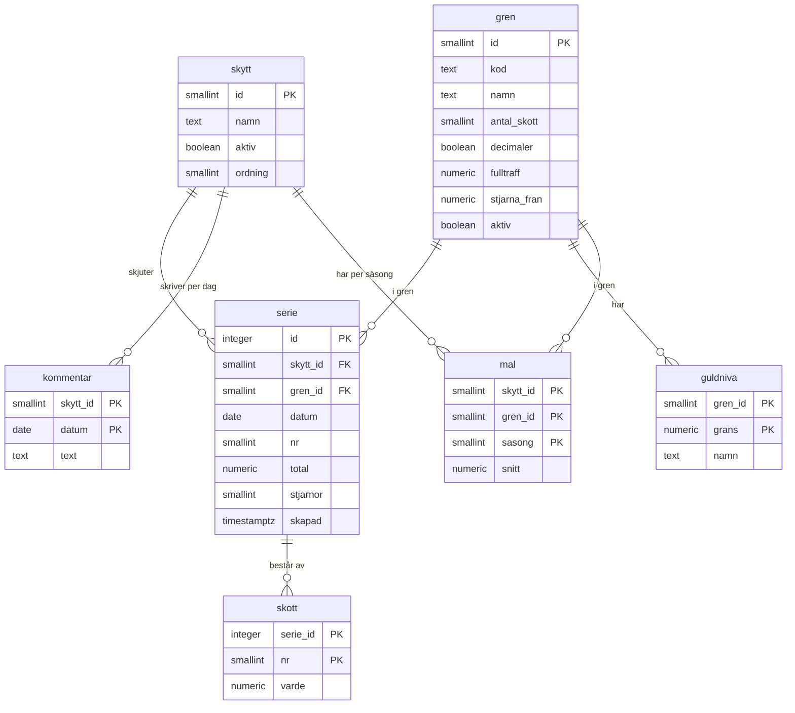

# Datamodell – schema `skytte`

Ligger i Supabase-projektet `tht` men är helt åtskilt från golfens tabeller. Uppdateras vid varje schemaändring (kopia i Obsidian: *Skyttestatistik - Datamodell*).

## Regler
- En serie är unik per skytt, gren, datum och serienummer.
- **Serietotal:** `serie.total` och `serie.stjarnor` ifyllda, inga rader i `skott`.
- **Skott för skott:** `total` och `stjarnor` tomma, en rad per skott i `skott`. Summa och stjärnor räknas i vyn.
- `gren.decimaler`: luftgevär 10 m har 0,0–10,9. Salongsgevär 50 m har heltal 0–10 och fullträff `fulltraff` = 10,1. En trigger stoppar värden som inte passar grenen.
- Stjärna: skott ≥ `gren.stjarna_fran` (10,2 på 10 m, 10,1 på 50 m).
- Guldnivå: serie med poäng **≥** `grans` (samma som Looker-rapporten räknade).
- Kommentar gäller en skytt och ett datum, oavsett gren.
- Säsongsmål (`mal`, sedan 2026-10-26): mål för snitt per serie per skytt, gren och säsong. Säsong = startåret, 1 augusti – 31 juli (2026 = 2026/27).

## Vyer
| Vy | Innehåll |
| --- | --- |
| `v_serie` | En rad per serie: skytt, gren, inmatningssätt, poäng, stjärnor, skotten som lista, ofullständig |
| `v_dag` | Ett tillfälle (skytt + gren + datum): antal serier, snitt, bästa, sämsta, stjärnor, kommentar |

## Behörighet
Row Level Security på alla tabeller: bara inloggade med `app_metadata.roll = 'skytte'` får läsa och skriva. `anon` har ingen åtkomst till schemat. Vyerna är `security_invoker`.
